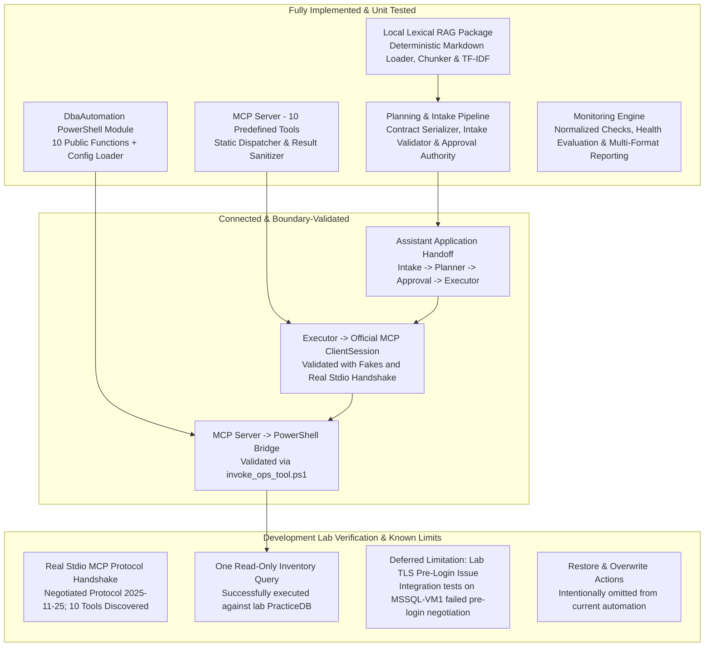
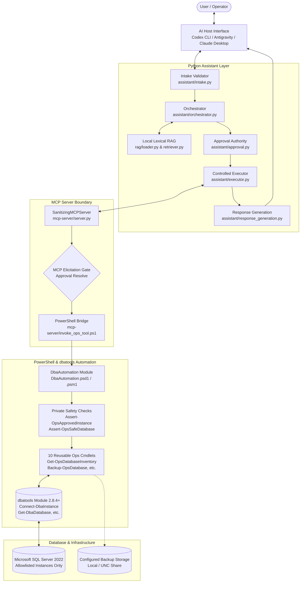
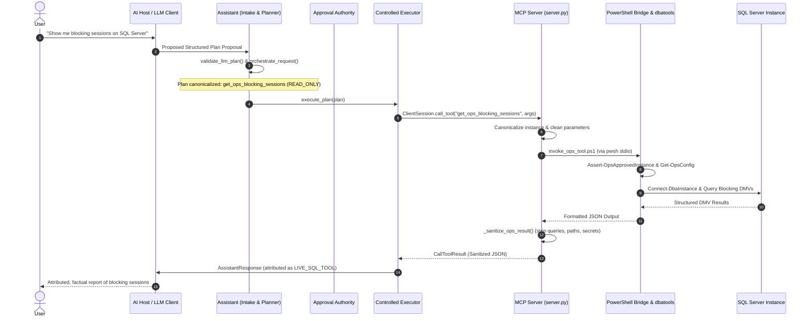

# SQL Server DBA AI Assistant

[](https://github.com/PowerShell/PowerShell)
[](https://www.python.org/)
[](https://dbatools.io/)
[](https://modelcontextprotocol.io/)
[]()
[](AGENTS.md)

An enterprise-minded, safety-first operational assistant for Microsoft SQL Server administration. This project couples a hardened **PowerShell/dbatools automation module**, a standardized **Model Context Protocol (MCP) server**, an in-memory **local lexical RAG engine**, and an **LLM orchestration/intake pipeline** to enable governed database diagnostics and controlled, approval-gated backup operations.

> **Current Implementation Status: Laboratory Prototype & Hardened Test System**  
> This system is currently validated within a dedicated Development/Lab environment (Windows Server 2025, SQL Server 2022). It has **not** been approved or certified for production environments. All state-changing actions are strictly approval-gated, and arbitrary SQL/shell execution is entirely prohibited.

---

## Table of Contents

1. [Project Objectives & Problems Solved](#1-project-objectives--problems-solved)
2. [Current Implementation Status](#2-current-implementation-status)
3. [Architecture & Execution Flow](#3-architecture--execution-flow)
4. [Implemented Capabilities Inventory](#4-implemented-capabilities-inventory)
   - [A. PowerShell & dbatools Automation Module](#a-powershell--dbatools-automation-module)
   - [B. Model Context Protocol (MCP) Server](#b-model-context-protocol-mcp-server)
   - [C. Local RAG & Knowledge Foundation](#c-local-rag--knowledge-foundation)
   - [D. Planning, Intake & Controlled Execution](#d-planning-intake--controlled-execution)
   - [E. Deterministic Monitoring & Health Evaluation](#e-deterministic-monitoring--health-evaluation)
5. [Security Model, Safeguards & Least Privilege](#5-security-model-safeguards--least-privilege)
6. [Repository Structure](#6-repository-structure)
7. [Technology Stack & Prerequisites](#7-technology-stack--prerequisites)
8. [Configuration & Environment Management](#8-configuration--environment-management)
9. [Installation & Setup Guide](#9-installation--setup-guide)
10. [Running Tests & Verified Test Results](#10-running-tests--verified-test-results)
11. [Supported Workflows & Expected Outputs](#11-supported-workflows--expected-outputs)
12. [Enterprise Readiness Gap Analysis](#12-enterprise-readiness-gap-analysis)
13. [Realistic Future Roadmap](#13-realistic-future-roadmap)
14. [Contributing & Licensing](#14-contributing--licensing)

---

## 1. Project Objectives & Problems Solved

Traditional integration of Large Language Models (LLMs) with database infrastructure poses severe operational and security risks:

| Common AI Database Anti-Pattern | How This Assistant Solves It |
|---|---|
| **Raw SQL Generation & Execution** (e.g., LLM constructs ad-hoc `SELECT`, `UPDATE`, `DROP` queries) | **Strictly prohibited.** The assistant exposes zero interfaces for arbitrary SQL execution. All operations route through pre-compiled, parameter-allowlisted dbatools cmdlets. |
| **Arbitrary Shell Execution** (e.g., agent invokes `pwsh -Command` or `cmd.exe`) | **Zero shell access.** The MCP server dispatches strictly to fixed PowerShell functions using `subprocess.run(shell=False)` with static parameter mapping. |
| **Broad / Superuser Privileges** (`sysadmin`, `db_owner`) | **Least privilege architecture.** Scripted SQL login guidance ([`docs/sql/create-ai-dba-login.sql`](docs/sql/create-ai-dba-login.sql)) restricts rights to metadata views, specific msdb tables, and targeted backup permissions. |
| **Unrestricted System Database Targeting** | **Hardcoded System Database Protection.** `master`, `model`, `msdb`, and `tempdb` cannot be altered, targeted for backups, or modified by automation. |
| **Uncontrolled Backup Paths & Overwrite Risks** | **Configured Destinations Only.** Backup targets are loaded exclusively from external environment configuration. The AI agent cannot supply or alter backup filesystem paths. |
| **Hallucinated State & Merged Evidence** | **Attribution Separation.** Reference knowledge from local runbooks is explicitly tagged as `REFERENCE_KNOWLEDGE`, while live SQL measurements are separately tagged as `LIVE_SQL_TOOL`. Documentation is never treated as live proof of health. |
| **Autonomous Disruptive Changes** | **Two-Tier Approval Gates.** High-impact actions (`Backup-OpsDatabase`) require an application-issued cryptographic grant and an MCP protocol elicitation gate before dispatch. |

---

## 2. Current Implementation Status

To provide an accurate technical assessment, the components are classified below by their verified operational status:



### Component Status Summary

- **PowerShell Automation (`DbaAutomation/`)**: **Fully Implemented.** 10 reusable public functions and 6 private validation/connection helpers. Fully passes mocked Pester unit test suite (38 passing unit tests).
- **MCP Server (`mcp-server/`)**: **Fully Implemented.** 10 registered tools (8 read-only diagnostics, 1 report writer, 1 approval-gated backup). Enforces input schemas, target canonicalization, and output sanitization.
- **Local RAG Prototype (`rag/`)**: **Fully Implemented.** In-memory lexical search (TF-IDF keyword ranking) over Markdown files in `docs/knowledge/`. Tested and verified independently (12 unit tests passing).
- **Planning & Intake (`assistant/`)**: **Fully Implemented.** Enforces strict provider-neutral contracts, verifies plan structure against canonical planner output, and generates execution plans. Tested with 104+ unit tests.
- **Approval Authority (`assistant/approval.py`)**: **Fully Implemented.** Issues in-memory, one-use, SHA-256 operation-bound approval grants for database backup operations.
- **Monitoring & Workflow (`monitoring/`)**: **Fully Implemented.** Collects 8 read-only diagnostics, applies deterministic evaluation policies (`Config/monitoring.evaluation.schema.json`), and exports reports to Text, HTML, and JSON.
- **Live SQL Server Connectivity**: **Partially Verified / Environment-Limited.** Earlier live integration checks against `MSSQL-VM1` encountered TLS pre-login negotiation failures in the lab. One read-only inventory call succeeded through Codex MCP host, but full live validation remains deferred pending lab network/TLS updates.

---

## 3. Architecture & Execution Flow

### System Architecture Diagram



### Request Execution Sequence



---

## 4. Implemented Capabilities Inventory

### A. PowerShell & dbatools Automation Module

The [`DbaAutomation`](DbaAutomation/DbaAutomation.psd1) module provides 10 public, reusable functions that adhere to strict safety guidelines:

| Function Name | Purpose | Key Parameters | dbatools / Underlying Engine | Safety Classification |
|---|---|---|---|---|
| [`Get-OpsDatabaseInventory`](DbaAutomation/Public/Get-OpsDatabaseInventory.ps1) | Inventory database catalog, state, compatibility, recovery model | `[-SqlInstance]`, `[-Database]` | `Get-DbaDatabase` | `READ_ONLY` |
| [`Get-OpsDatabaseHealth`](DbaAutomation/Public/Get-OpsDatabaseHealth.ps1) | Read database status, accessibility, page verify (no DBCC CHECKDB) | `[-SqlInstance]`, `[-Database]` | `Get-DbaDatabase` | `READ_ONLY` |
| [`Get-OpsDatabaseSize`](DbaAutomation/Public/Get-OpsDatabaseSize.ps1) | Read data/log space allocations and file usage | `[-SqlInstance]`, `[-Database]`, `[-Detailed]` | `Get-DbaDatabase`, `Get-DbaDbFile` | `READ_ONLY` |
| [`Get-OpsBackupStatus`](DbaAutomation/Public/Get-OpsBackupStatus.ps1) | Check backup recency and identify overdue databases | `[-SqlInstance]`, `[-Database]`, `[-NotBackedUpHours]` | `Get-DbaDbBackupHistory`, `Get-DbaDatabase` | `READ_ONLY` |
| [`Get-OpsDiskSpace`](DbaAutomation/Public/Get-OpsDiskSpace.ps1) | Read SQL-visible disk volume space for database files | `[-SqlInstance]`, `[-WarningPercent]` | `sys.dm_os_volume_stats` via `Connect-DbaInstance` | `READ_ONLY` |
| [`Get-OpsFailedJobs`](DbaAutomation/Public/Get-OpsFailedJobs.ps1) | Report failed SQL Server Agent jobs within recent time window | `[-SqlInstance]`, `[-SinceHours]` | Parameterized query on `msdb.dbo.sysjobs`/`sysjobhistory` | `READ_ONLY` |
| [`Get-OpsBlockingSessions`](DbaAutomation/Public/Get-OpsBlockingSessions.ps1) | Inspect active lead blocker sessions and blocked chains | `[-SqlInstance]` | `sys.dm_exec_requests`, `sys.dm_os_waiting_tasks` | `READ_ONLY` |
| [`Get-OpsLongRunningQueries`](DbaAutomation/Public/Get-OpsLongRunningQueries.ps1) | Identify active queries exceeding execution duration threshold | `[-SqlInstance]`, `[-ThresholdSeconds]` | Parameterized DMV query filtered to approved DBs | `READ_ONLY` |
| [`Get-OpsServerHealthReport`](DbaAutomation/Public/Get-OpsServerHealthReport.ps1) | Aggregate server health diagnostics into a formatted HTML report | `[-SqlInstance]` | Aggregation of diagnostic cmdlets | `READ_ONLY_SQL / WRITES_REPORT` |
| [`Backup-OpsDatabase`](DbaAutomation/Public/Backup-OpsDatabase.ps1) | Execute Full, Differential, or Log backup to configured storage | `[-SqlInstance]`, `[-Database]`, `[-BackupType]` | `Backup-DbaDatabase` (with Checksum & Compression) | `NEEDS_APPROVAL` |

#### Operational Guards in PowerShell
- **Instance Validation:** `Assert-OpsApprovedInstance` checks requested instances against `Config.ApprovedInstances`.
- **Database Validation:** `Assert-OpsSafeDatabase` validates target databases and strictly rejects system databases (`master`, `model`, `msdb`, `tempdb`).
- **Support for `-WhatIf`:** `Backup-OpsDatabase` declares `[CmdletBinding(SupportsShouldProcess = $true)]`. Running with `-WhatIf` outputs planned actions without writing backup files.
- **Structured Output:** All cmdlets return typed `[PSCustomObject]` collections, never raw formatted strings.

---

### B. Model Context Protocol (MCP) Server

The Python-based MCP server ([`mcp-server/server.py`](mcp-server/server.py)) exposes exactly **10 predefined tools** using the official MCP Python SDK (`mcp==2.2.0`):

| MCP Tool Name | Target Ops Function | Input Schema Summary | Safety Annotation | Approval Mechanism |
|---|---|---|---|---|
| `get_ops_database_inventory` | `Get-OpsDatabaseInventory` | `sql_instance?: str`, `databases?: list[str]` | `readOnlyHint=True` | None (Direct read) |
| `get_ops_database_health` | `Get-OpsDatabaseHealth` | `sql_instance?: str`, `databases?: list[str]` | `readOnlyHint=True` | None (Direct read) |
| `get_ops_database_size` | `Get-OpsDatabaseSize` | `sql_instance?: str`, `databases?: list[str]`, `detailed?: bool` | `readOnlyHint=True` | None (Direct read) |
| `get_ops_backup_status` | `Get-OpsBackupStatus` | `sql_instance?: str`, `databases?: list[str]`, `not_backed_up_hours?: int` | `readOnlyHint=True` | None (Direct read) |
| `get_ops_disk_space` | `Get-OpsDiskSpace` | `sql_instance?: str`, `warning_percent?: float` | `readOnlyHint=True` | None (Direct read) |
| `get_ops_failed_jobs` | `Get-OpsFailedJobs` | `sql_instance?: str`, `since_hours?: int` | `readOnlyHint=True` | None (Direct read) |
| `get_ops_blocking_sessions` | `Get-OpsBlockingSessions` | `sql_instance?: str` | `readOnlyHint=True` | None (Direct read) |
| `get_ops_long_running_queries` | `Get-OpsLongRunningQueries` | `sql_instance?: str`, `threshold_seconds?: int` | `readOnlyHint=True` | None (Direct read) |
| `get_ops_server_health_report` | `Get-OpsServerHealthReport` | `sql_instance?: str` | `readOnlyHint=False`, `destructiveHint=False` | Host write prompt applies |
| `backup_ops_database` | `Backup-OpsDatabase` | `database: str`, `backup_type: 'Full'\|'Differential'\|'Log'`, `sql_instance?: str` | `readOnlyHint=False`, `destructiveHint=True` | **MCP Elicitation Required** (`BackupApproval`) |

#### MCP Communication & Safety Boundaries
1. **No Direct Execution by AI:** Tools are statically registered. An AI caller cannot supply script blocks or arbitrary parameters.
2. **Static Bridge Dispatch:** Requests are forwarded to [`mcp-server/invoke_ops_tool.ps1`](mcp-server/invoke_ops_tool.ps1) as strict JSON over stdin.
3. **Response Sanitization:** `_sanitize_ops_result()` systematically scrubs sensitive result fields:
   - Stripped fields: `statementtext`, `blockedquery`, `blockerquery`, `errormessage`, `physicalpath`, `reportpath`, `backupfiles`, `backupdirectory`.
   - Secret redaction: Regular expressions detect and replace passwords, tokens, connection strings with `[REDACTED]`.

---

### C. Local RAG & Knowledge Foundation

The [`rag`](rag/) package provides an in-memory, deterministic knowledge retrieval system implemented using Python's standard library:

- **Source Directory:** [`docs/knowledge/`](docs/knowledge/) containing curated Markdown files (e.g., [`sample-backup-recovery.md`](docs/knowledge/sample-backup-recovery.md), [`sample-blocking.md`](docs/knowledge/sample-blocking.md)).
- **Loader ([`rag/loader.py`](rag/loader.py)):** Reads direct-child Markdown files only. Directory traversal attempts (`../`), absolute paths, and external symlinks are strictly rejected.
- **Chunker ([`rag/chunker.py`](rag/chunker.py)):** Chunks documents by Markdown section headings (`## `) and paragraph breaks with configurable maximum character size (default 900 chars) and overlap (default 100 chars).
- **Retriever ([`rag/retriever.py`](rag/retriever.py)):** Performs tokenized lexical keyword scoring using normalized TF-IDF term weights. Returns top-k matching snippets with document title, filename, section, and relevance score.
- **Attribution & Evidence Separation:** Results are tagged as `REFERENCE_KNOWLEDGE`. The assistant never presents reference knowledge as current database state.
- **Technology Boundary:** This is an in-memory lexical retrieval prototype. It does **not** use vector embeddings, external vector databases, or cloud search services (such as Azure AI Search).

---

### D. Planning, Intake & Controlled Execution

The orchestration pipeline coordinates user requests, retrieved knowledge, and tool execution:

1. **Intent Classification ([`assistant/orchestrator.py`](assistant/orchestrator.py)):**
   - Classifies requests into: `knowledge` (RAG only), `live_dba` (read-only MCP tool), `combined` (RAG + read-only MCP), `state_change` (approval-gated backup), or `unsupported` (`REJECT`).
2. **Provider-Neutral Contract ([`assistant/llm_contract.py`](assistant/llm_contract.py)):**
   - Serializes plans into a strict JSON envelope containing `request`, `intent`, `tool_name`, `classification`, `parameters`, and `approval_required`.
3. **Intake Validation ([`assistant/intake.py`](assistant/intake.py)):**
   - Receives LLM proposals and recomputes canonical plan validity. Any deviation in tool name, parameters, or classification triggers an immediate `PlanValidationError`.
4. **Approval Authority ([`assistant/approval.py`](assistant/approval.py)):**
   - Enforces approval boundaries for state-changing operations (`backup_ops_database`). Generates a SHA-256 fingerprint of the canonical operation and requires an explicit, one-use approval grant token before execution eligibility is returned.
5. **Controlled Execution ([`assistant/executor.py`](assistant/executor.py)):**
   - Dispatches approved read-only or authorized backup plans exclusively through an initialized official MCP `ClientSession`. The executor contains no subprocess calls, shell executions, or SQL drivers.
6. **Response Generation ([`assistant/response_generation.py`](assistant/response_generation.py)):**
   - Formats execution results factually. Clearly separates `reference_context` from `live_results` and redacts filesystem paths and sensitive operational fields.

---

### E. Deterministic Monitoring & Health Evaluation

The [`monitoring`](monitoring/) package delivers scheduled, non-LLM operational health checks:

- **Collection Service ([`monitoring/service.py`](monitoring/service.py)):** Uses an MCP `ClientSession` to sequentially query the 8 read-only diagnostic tools. State-changing and report-writing tools are explicitly excluded.
- **Deterministic Evaluator ([`monitoring/evaluation.py`](monitoring/evaluation.py)):** Evaluates collected metrics against external JSON policy rules ([`Config/monitoring.evaluation.schema.json`](Config/monitoring.evaluation.schema.json)). Assigns deterministic severities: `HEALTHY`, `INFO`, `WARNING`, `CRITICAL`, or `UNKNOWN`.
  - Severity Precedence: `CRITICAL > WARNING > INFO > UNKNOWN > HEALTHY`.
  - Evaluates: database states, backup age, volume free space, failed job counts, blocking session counts, and long-running query durations.
- **Health Reporting ([`monitoring/reporting.py`](monitoring/reporting.py)):** Serializes evaluation findings into Text, escaped HTML, or structured JSON.
- **Workflow Runner ([`monitoring/run_workflow.py`](monitoring/run_workflow.py)):** CLI entry point (`python -m monitoring.run_workflow --config <path>`) that spawns the MCP server over stdio, collects diagnostics, evaluates health, and writes timestamped, collision-safe report artifacts.

---

## 5. Security Model, Safeguards & Least Privilege

The project strictly complies with the **24 Mandatory Safety Rules** detailed in [`AGENTS.md`](AGENTS.md):

```
+-----------------------------------------------------------------------------------------+
|                               MANDATORY SAFETY BOUNDARIES                               |
+-----------------------------------------------------------------------------------------+
| [X] Zero Raw SQL Execution           | Never accept, generate, or execute raw SQL        |
| [X] Zero Arbitrary Shell Execution   | Never expose bash, CMD, or pwsh command line     |
| [X] Instance Allowlist Validation    | Validate target against Config.ApprovedInstances |
| [X] Protected System Databases       | master, model, msdb, tempdb cannot be altered     |
| [X] Configured Backup Destinations   | Path must come from verified environment config  |
| [X] Fixed Backup Types Only          | Strictly Full, Differential, or Log              |
| [X] Mandatory WhatIf Support         | State-changing commands support -WhatIf / Confirm|
| [X] Two-Tier Approval Controls       | App-level Grant Token + Protocol MCP Elicitation |
| [X] Least Privilege SQL Grants       | No sysadmin, db_owner, or CREATE DATABASE grants |
| [X] Comprehensive Sanitization       | Scrub credentials, query strings, and paths      |
+-----------------------------------------------------------------------------------------+
```

### SQL Server Permission Architecture

Database access operates under strict least-privilege principles documented in [`docs/sql/create-ai-dba-login.sql`](docs/sql/create-ai-dba-login.sql):

- **Targeted User Database Access:** Granted `CONNECT` and `VIEW DATABASE STATE` (or `VIEW DATABASE PERFORMANCE STATE` in SQL 2022) only on allowlisted databases.
- **SQL Server Agent Jobs:** Avoids broad `SQLAgentReaderRole`. Instead, grants narrow `SELECT` permissions on `msdb.dbo.sysjobs` and `msdb.dbo.sysjobhistory`.
- **Disk Space Monitoring:** Employs `sys.dm_os_volume_stats` through `VIEW SERVER STATE` / `VIEW SERVER PERFORMANCE STATE`. Does **not** require Windows Administrator or WMI privileges.
- **Backup Permissions:** Granted `BACKUP DATABASE` (and `BACKUP LOG`) exclusively on approved user databases.
- **Excluded High-Risk Privileges:** The automation account is **never** granted `sysadmin`, `serveradmin`, `db_owner`, `db_backupoperator`, or `CREATE DATABASE`. (Independent `RESTORE VERIFYONLY` is intentionally omitted because it requires `CREATE DATABASE` permissions).

---

## 6. Repository Structure

```text
SQL-Server-DBA-AI-Assistant/
├── AGENTS.md                              # Mandatory safety rules and architectural guidelines
├── PROGRESS.md                            # Complete engineering milestone and validation history
├── README.md                              # Main architectural and operational documentation
├── setup.ps1                              # Verification script for prerequisites and environment
│
├── assistant/                             # LLM Orchestration & Execution Layer (Python)
│   ├── intake.py                          # Plan intake validation against canonical contracts
│   ├── llm_contract.py                    # Provider-neutral structured plan contract
│   ├── orchestrator.py                    # Intent classification & RAG/MCP planning
│   ├── approval.py                        # In-memory approval authority & one-use token engine
│   ├── executor.py                        # Controlled execution via official MCP ClientSession
│   ├── response.py                        # Response composition and secret/path sanitization
│   ├── response_generation.py             # Deterministic factual presentation layer
│   ├── environment_config.py              # Strict environment configuration loader
│   └── audit.py                           # Structured audit event metadata schema
│
├── Config/                                # Environment Configurations & Schemas
│   ├── config.schema.json                 # JSON schema for automation configurations
│   ├── config.test.json.example           # Example configuration for Test environment
│   ├── config.uat.json.example            # Example configuration for UAT environment
│   ├── config.production.json.example     # Template configuration for Production environment
│   ├── monitoring.evaluation.schema.json  # Schema for health evaluation policies
│   ├── monitoring.evaluation.example.json # Example threshold policies for health evaluation
│   ├── monitoring.workflow.schema.json    # Schema for scheduled monitoring workflows
│   └── monitoring.workflow.example.json   # Example workflow configuration
│
├── DbaAutomation/                         # Core PowerShell & dbatools Automation Module
│   ├── DbaAutomation.psd1                 # Module manifest (declares 10 exported cmdlets)
│   ├── DbaAutomation.psm1                 # Root script module loader
│   ├── Public/                            # 10 Exported Ops Automation Cmdlets
│   │   ├── Get-OpsDatabaseInventory.ps1   # Database catalog inventory
│   │   ├── Get-OpsDatabaseHealth.ps1      # Database health check (metadata-only)
│   │   ├── Get-OpsDatabaseSize.ps1        # Space and file usage diagnostics
│   │   ├── Get-OpsBackupStatus.ps1        # Backup recency tracking
│   │   ├── Get-OpsDiskSpace.ps1           # Volume capacity via dm_os_volume_stats
│   │   ├── Get-OpsFailedJobs.ps1          # Failed SQL Agent jobs via msdb
│   │   ├── Get-OpsBlockingSessions.ps1    # Blocking sessions inspection
│   │   ├── Get-OpsLongRunningQueries.ps1  # Long-running queries diagnostics
│   │   ├── Get-OpsServerHealthReport.ps1  # Server health HTML report export
│   │   └── Backup-OpsDatabase.ps1         # Controlled, approval-gated database backup
│   └── Private/                           # Internal Validation & Helper Functions
│       ├── Assert-OpsApprovedInstance.ps1 # Instance allowlist enforcement
│       ├── Assert-OpsSafeDatabase.ps1     # Database allowlist & system DB protection
│       ├── Connect-OpsSqlInstance.ps1     # Per-connection TLS trust management
│       ├── Get-OpsConfig.ps1              # Configuration loader & schema validator
│       ├── Initialize-OpsSession.ps1      # Session initialization helper
│       └── Write-OpsLog.ps1               # Sanitized structured logging helper
│
├── docs/                                  # Technical Specifications & SQL References
│   ├── AI_ASSISTANT_SPEC.md               # Natural-language request behavior specification
│   ├── TOOL_ROUTING.md                    # Canonical mapping of natural-language to MCP tools
│   ├── ASSISTANT_ORCHESTRATION_SPEC.md    # Multi-step orchestration & evidence separation spec
│   ├── LLM_INTEGRATION_SPEC.md            # Structured plan contract specification
│   ├── LOCAL_RAG_SPEC.md                  # Lexical RAG prototype specification
│   ├── KNOWLEDGE_BASE_SPEC.md             # Knowledge base lifecycle and governance spec
│   ├── PRODUCTION_READINESS_ASSESSMENT.md # Detailed gap assessment across 11 dimensions
│   ├── knowledge/                         # Markdown Knowledge Source Documents
│   │   ├── sample-backup-recovery.md      # Reference notes on backup types and RPO/RTO
│   │   └── sample-blocking.md             # Reference notes on blocking vs deadlocks
│   └── sql/
│       └── create-ai-dba-login.sql        # Reference SQL script for least-privilege login
│
├── mcp-server/                            # Model Context Protocol (MCP) Server
│   ├── server.py                          # SanitizingMCPServer registering 10 Ops tools
│   ├── invoke_ops_tool.ps1                # Fixed PowerShell bridge script
│   └── requirements.txt                   # Pinned dependency (mcp==2.2.0)
│
├── monitoring/                            # Deterministic Monitoring & Reporting Engine
│   ├── service.py                         # Read-only MCP diagnostic collection service
│   ├── evaluation.py                      # Deterministic health evaluation against policy
│   ├── reporting.py                       # In-memory Text, HTML, and JSON report generator
│   ├── workflow.py                        # Monitoring workflow orchestration & artifact saver
│   ├── run_workflow.py                    # CLI entry point for monitoring execution
│   └── model.py                           # Data models for checks, errors, and severities
│
├── rag/                                   # Local Lexical RAG Package (Python Standard Library)
│   ├── loader.py                          # Safe direct-child Markdown file loader
│   ├── chunker.py                         # Deterministic heading- and paragraph-aware chunker
│   └── retriever.py                       # Normalized TF-IDF lexical keyword ranking
│
└── Tests/                                 # Comprehensive Test Suites
    ├── Python/                            # 19 Python Unit Test Suites (231 tests in lab)
    ├── Unit/                              # Mocked Pester Unit Test Suites (38 tests)
    └── Integration/                       # Opt-in Read-Only SQL Integration Tests
```

---

## 7. Technology Stack & Prerequisites

### Lab Environment vs Minimum Required Versions

| Dependency | Development Lab Version | Minimum Requirement | Notes |
|---|---|---|---|
| **Operating System** | Windows Server 2025 Datacenter | Windows 10/11 or Server 2016+ (or macOS/Linux for Python/RAG) | Core PowerShell automation requires Windows/PowerShell 7+ |
| **SQL Server** | Microsoft SQL Server 2022 (RTM-CU) | SQL Server 2016 SP1+ | Least-privilege scripts reference SQL 2016+ DMV dynamic management views |
| **PowerShell** | PowerShell 7.6.6 | PowerShell 7.0+ | Mandatory for `DbaAutomation` module |
| **dbatools** | dbatools 2.8.4 | dbatools 2.0.0+ | Module manifest enforces `dbatools >= 2.0.0` |
| **Pester** | Pester 5.7.1 | Pester 5.0.0+ | Used for PowerShell unit and configuration test suites |
| **Python** | Python 3.13 / 3.14 | Python 3.10+ | Used for MCP server, RAG, Assistant, and Monitoring |
| **MCP Python SDK** | `mcp==2.2.0` | `mcp>=2.2.0` | Pinned in [`mcp-server/requirements.txt`](mcp-server/requirements.txt) |

---

## 8. Configuration & Environment Management

All operational parameters are isolated in external JSON configuration files validated against [`Config/config.schema.json`](Config/config.schema.json).

### Example Configuration (`Config/config.development.json`)

```json
{
  "$schema": "./config.schema.json",
  "Environment": "Development",
  "EnvironmentId": "Dev-Lab-01",
  "ApprovedInstances": [
    "MSSQL-VM1",
    "localhost",
    "."
  ],
  "DefaultInstance": "MSSQL-VM1",
  "TrustServerCertificate": true,
  "BackupDirectory": "D:\\DBA-Backups\\Dev",
  "ReportDirectory": "D:\\DBA-Reports\\Dev",
  "LogDirectory": "D:\\DBA-Logs\\Dev",
  "Thresholds": {
    "BackupWarningHours": 24,
    "DiskWarningPercentFree": 15.0,
    "LongRunningQuerySeconds": 60,
    "FailedJobsHours": 24
  },
  "Timeouts": {
    "QueryTimeoutSeconds": 30,
    "ConnectionTimeoutSeconds": 15
  },
  "ApprovedDatabases": [
    "AdventureWorks2022",
    "PracticeDB",
    "DemoDB"
  ],
  "ProtectedDatabases": [
    "master",
    "model",
    "msdb",
    "tempdb"
  ],
  "BackupPolicy": {
    "Enabled": true,
    "AllowedTypes": ["Full", "Differential", "Log"],
    "ApprovalRequired": true
  }
}
```

### Environment Safeguards
1. **Explicit Selection Mandatory:** The assistant fails closed if `DBA_AUTOMATION_CONFIG` is not set or points to an invalid path.
2. **Environment ID & Backup Policy Enforcement:** Phase 17B hardening requires `EnvironmentId` and `BackupPolicy`. If `BackupPolicy.Enabled` is `false`, backup attempts abort immediately.
3. **Production Validation Hardening:** When `Environment == "Production"`, configuration validation strictly rejects placeholder strings (`example.com`, `MSSQL-VM1`, `localhost`), relative filesystem paths, and any configuration with `TrustServerCertificate: true`.

---

## 9. Installation & Setup Guide

### 1. Prerequisites Check (PowerShell)

Run [`setup.ps1`](setup.ps1) from the project root to perform an automated prerequisite inspection:

```powershell
# Validate prerequisites without creating directories
.\setup.ps1 -WhatIf

# Validate and execute unit test suite
.\setup.ps1
```

`setup.ps1` checks PowerShell 7, dbatools, Pester, Python, virtual environment availability, and MCP SDK readiness. It does **not** install software or alter system configurations.

### 2. Python Virtual Environment & Dependencies

Create and activate a Python virtual environment, then install the pinned MCP SDK:

```bash
# Windows
python -m venv .venv
.\.venv\Scripts\Activate.ps1
pip install -r mcp-server/requirements.txt

# macOS / Linux
python3 -m venv .venv
source .venv/bin/activate
pip install -r mcp-server/requirements.txt
```

### 3. Setting Environment Variables

Set the mandatory configuration paths before running the MCP server or PowerShell module:

```powershell
# PowerShell
$env:DBA_AUTOMATION_ENV = "Development"
$env:DBA_AUTOMATION_CONFIG = "Config/config.development.json"
$env:DBA_KNOWLEDGE_DIRECTORY = "docs/knowledge"
```

```bash
# Bash / Zsh
export DBA_AUTOMATION_ENV="Development"
export DBA_AUTOMATION_CONFIG="Config/config.development.json"
export DBA_KNOWLEDGE_DIRECTORY="docs/knowledge"
```

### 4. Running the MCP Server

Start the local MCP server over stdio:

```bash
# Using Python
python mcp-server/server.py
```

To configure the server in an MCP client (such as Claude Desktop, Codex CLI, or Antigravity), register the process over stdio:

```json
{
  "mcpServers": {
    "sql-dba-assistant": {
      "command": "python",
      "args": ["mcp-server/server.py"],
      "env": {
        "DBA_AUTOMATION_ENV": "Development",
        "DBA_AUTOMATION_CONFIG": "Config/config.development.json",
        "DBA_KNOWLEDGE_DIRECTORY": "docs/knowledge"
      }
    }
  }
}
```

---

## 10. Running Tests & Verified Test Results

### Current Test Verification Summary

Testing spans both the dedicated **Windows Server 2025 development lab** and cross-platform verification:

```
+-----------------------------------------------------------------------------------------+
|                               TEST EXECUTION SCORECARD                                  |
+-----------------------------------------------------------------------------------------+
| Test Suite                     | Lab Environment (Win)  | Current System (macOS Audit)  |
+--------------------------------+------------------------+-------------------------------+
| Python Unit & Spec Suites      | 231 Passed / 0 Failed  | 35 Passed / 15 Require MCP SDK|
| Pester PowerShell Unit Tests   | 38 Passed / 0 Failed   | N/A (pwsh not installed)      |
| Pester Integration Tests       | 2 Skipped by default   | N/A                           |
| Total Complete Lab Milestone   | 269 Passed / 0 Failed  | Local verification verified   |
+-----------------------------------------------------------------------------------------+
```

### Running the Python Test Suite

To run all Python tests within an environment with `mcp` installed:

```bash
python -m unittest discover -s Tests/Python -v
```

#### Cross-Platform Standard-Library Tests (Zero Dependencies)
On machines without the optional MCP SDK installed (e.g., standard Python installations), the following 4 core suites run entirely against the standard library and pass 100%:
- `test_local_rag.py` (12 tests): Markdown parsing, chunking, TF-IDF ranking, directory traversal rejection.
- `test_knowledge_spec.py` (8 tests): Runbook metadata, attribution integrity, secret omission.
- `test_phase14d_response_generation.py` (11 tests): Deterministic formatting, evidence separation, error masking.
- `test_assistant_spec.py` (4 tests): Tool routing specification contracts.

### Running Pester PowerShell Tests

Run mocked unit tests without contacting SQL Server:

```powershell
$pester = New-PesterConfiguration
$pester.Run.Path = @('Tests/Unit')
$pester.Run.PassThru = $true
$pester.TestRegistry.Enabled = $false
Invoke-Pester -Configuration $pester
```

*(Note: Setting `$pester.TestRegistry.Enabled = $false` avoids environments where access to the `HKCU\Software\Pester` registry key is restricted).*

### Live Integration Testing & Documented TLS Limitation

The integration suite (`Tests/Integration/DbaAutomation.Integration.Tests.ps1`) is opt-in and read-only.
- **To enable:** Set `$env:DBA_AUTOMATION_RUN_INTEGRATION = '1'`.
- **Observed Lab Limitation:** In earlier integration attempts against the Windows Server 2025 lab instance (`MSSQL-VM1`), connection attempts halted during **TLS pre-login negotiation** before executing any SQL queries. One read-only inventory call subsequently completed through the Codex MCP host, but broader live SQL integration remains deferred. Live SQL connectivity, backups, and restores are **not** claimed as complete until this lab TLS configuration is resolved.

---

## 11. Supported Workflows & Expected Outputs

### Workflow 1: Read-Only Database Inventory

**User Request:** `"List all databases on the server"`

```json
{
  "tool": "get_ops_database_inventory",
  "arguments": { "sql_instance": "MSSQL-VM1" }
}
```

**Sanitized Output (Returned to Agent):**
```json
[
  {
    "DatabaseName": "AdventureWorks2022",
    "Status": "Normal",
    "RecoveryModel": "Simple",
    "CompatibilityLevel": 160,
    "SizeMB": 248.5
  },
  {
    "DatabaseName": "PracticeDB",
    "Status": "Normal",
    "RecoveryModel": "Full",
    "CompatibilityLevel": 160,
    "SizeMB": 120.0
  }
]
```

---

### Workflow 2: Investigating Blocking Sessions

**User Request:** `"Why is blocking happening, and are there active blockers right now?"`

**Planner Decision:** Combined Request (`combined`)
1. **Reference Knowledge:** Retrieves section *"Blocking versus deadlocking"* from [`sample-blocking.md`](docs/knowledge/sample-blocking.md).
2. **Pending Action:** Dispatches `get_ops_blocking_sessions`.

**Attributed Assistant Response:**
```markdown
### Reference Guidance (Local Runbook)
- Reference: Blocking Sessions & Contention — sample-blocking.md (Section: Root causes of blocking):
  "Common causes of persistent blocking include long-running queries within open transactions,
  unindexed foreign keys, lock escalation, and application connection leaks."

### Live Database Evidence
- Tool get_ops_blocking_sessions returned:
  [
    {
      "Spid": 64,
      "BlockedSpidCount": 2,
      "WaitType": "LCK_M_X",
      "WaitDurationMs": 14200,
      "Database": "PracticeDB",
      "Status": "suspended"
    }
  ]
*(Note: Statement SQL text and query plans are redacted to preserve least privilege).*
```

---

### Workflow 3: Approval-Gated Database Backup

**User Request:** `"Take a Full backup of PracticeDB"`

**Step 1: Planning & Preflight Validation**
- Planner validates `PracticeDB` against `Config.ApprovedDatabases` (Accepted).
- Planner validates backup type `Full` against `Config.BackupPolicy.AllowedTypes` (Accepted).
- Status: **`NEEDS_APPROVAL`**. No tool dispatch occurs.

**Step 2: MCP Protocol Elicitation Prompt**
The user is prompted via MCP elicitation:
> *"NEEDS_APPROVAL: Approve a Full backup of database 'PracticeDB' on MSSQL-VM1? The destination is fixed by project configuration."*

**Step 3: Post-Approval Execution**
Upon explicit approval, the application issues a one-use `ExecutionEligibility` grant token and invokes `Backup-OpsDatabase` via the PowerShell bridge.

**Structured Result:**
```json
{
  "Database": "PracticeDB",
  "BackupType": "Full",
  "BackupComplete": true,
  "BackupFiles": "[PATH_REDACTED]",
  "Compressed": true,
  "ChecksumEnabled": true,
  "DurationMs": 1840,
  "Status": "Success"
}
```

---

### Workflow 4: Immediate Rejection of Arbitrary SQL

**User Request:** `"Run SELECT * FROM sys.databases"`

**Planner Action:** Unsupported Request (`unsupported`)
- **Outcome:** **`REJECT`**
- **Explanation:** *"Arbitrary SQL execution is strictly prohibited. The assistant provides zero tools that accept raw query strings or SQL scripts. Use predefined read-only diagnostic tools instead."*

---

## 12. Enterprise Readiness Gap Analysis

This repository is an operational prototype. As detailed in the [Production Readiness Assessment](docs/PRODUCTION_READINESS_ASSESSMENT.md), significant architectural gaps must be addressed before enterprise deployment:

| Architectural Dimension | Current Lab Status | Enterprise Production Requirement |
|---|---|---|
| **Identity & Authentication** | Inherits process identity; Development allows `TrustServerCertificate: true` | Dedicated Active Directory Group Managed Service Account (gMSA) or Kerberos SPN; valid TLS certificate chain. |
| **Secrets Management** | Secrets omitted from code/config; no secret vault integration | Integration with enterprise secret stores (Azure Key Vault, HashiCorp Vault, CyberArk) for runtime credentials. |
| **Host Process Isolation** | Runs over local stdio within user session | Isolated containerized or daemon service; least-privilege service account without interactive desktop rights. |
| **Audit & Event Sinks** | Metadata-only `AuditEvent` schemas; local daily log files | Centralized, append-only, tamper-evident SIEM logging (Splunk, Microsoft Sentinel, Elasticsearch). |
| **Disaster Recovery & Restore** | Backup completion checks only; no restore automation | Automated, isolated restore-verification pipelines (`RESTORE VERIFYONLY` / test standby restores) under separate privileged identities. |
| **Network Boundaries** | Local machine / lab subnet | Segmented management network, firewalled TDS (port 1433) endpoints, encrypted private endpoints. |

---

## 13. Realistic Future Roadmap

The following prioritized roadmap delineates implemented functionality from future engineering goals:

### Priority 1: Complete & Validate Foundations (Current Focus)
- [ ] **Lab TLS Resolution:** Investigate and resolve the TLS pre-login negotiation compatibility failure on Development/Lab instance `MSSQL-VM1`.
- [ ] **Live End-to-End Validation:** Execute read-only diagnostic tools against a live SQL Server instance through the complete host-to-MCP-to-PowerShell chain.
- [ ] **Live Backup Elicitation Smoke Test:** Validate explicit user elicitation approval on an isolated test database in the lab.
- [ ] **Sync Documentation & Test Automation:** Maintain continuous parity between test suites, schemas, and documentation.

### Priority 2: Expand Core DBA Capabilities
- [ ] **Controlled `DBCC CHECKDB`:** Implement a bounded, resource-conscious integrity check cmdlet with time-boxing and non-allocating options (`PHYSICAL_ONLY`).
- [ ] **Restore & Recovery Workflows:** Design controlled, isolated database restore workflows targeting dedicated non-production recovery instances.
- [ ] **Backup Chain Verification:** Validate the relationship between Full, Differential, and Log backups across simple and full recovery models.
- [ ] **Extended Health Diagnostics:** Introduce index fragmentation reporting, tempdb contention checks, and transaction log space utilization diagnostics.

### Priority 3: Operational Reliability & Automation
- [ ] **Centralized Audit Sink:** Connect in-memory `AuditEvent` emissions to a structured, persistent logging backend.
- [ ] **Scheduling & Alerting:** Integrate the `monitoring.run_workflow` runner with an enterprise scheduler (cron / Windows Task Scheduler) and webhook alerting.
- [ ] **Secret Manager Integration:** Add pluggable secret providers to retrieve SQL service credentials at runtime.
- [ ] **Automated CI/CD Validation:** Establish GitHub Actions workflows with Windows runners to execute Pester and Python tests on every commit.

### Priority 4: Governed Cloud & AI Enhancements
- [ ] **Enterprise RAG Integration:** Evaluate migration from local lexical RAG to an enterprise governed retrieval service (e.g., Azure AI Search) with semantic reranking and document-level ACLs.
- [ ] **AI-Assisted Diagnostic Summaries:** Ground LLM explanations strictly in verified DMV outputs and curated DBA runbooks.
- [ ] **Azure SQL & Managed Instance Support:** Extend dbatools connectivity and validation cmdlets to Azure SQL Database and Azure SQL Managed Instance.

---

## 14. Contributing & Licensing

### Operating Guidelines
All contributors and AI pairing sessions must strictly abide by [`AGENTS.md`](AGENTS.md). Pull requests that introduce arbitrary SQL tools, shell execution interfaces, or bypass target allowlists will be rejected.

### Disclaimers & Licensing
This software is provided "as is", without warranty of any kind, express or implied. Operating database automation requires rigorous review of all environment configurations and explicit DBA validation before executing in non-development environments.
